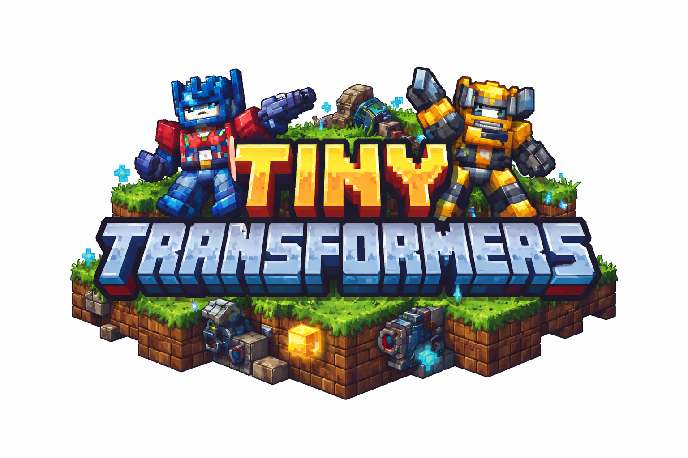
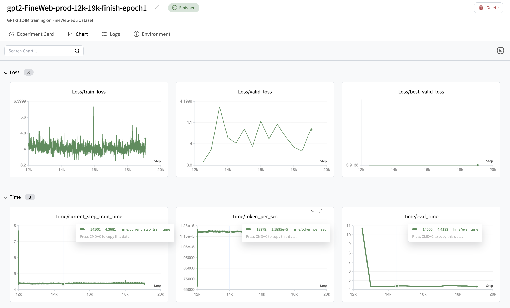

# Build a Tiny Transformers (GPT2)
This repository contains my code and notes for implementing a tiny decoder only transformers(124M GPT2).

Training data is the FineWeb-Edu 10B tokens dataset, I used the tokenized version on [Kaggle](https://www.kaggle.com/datasets/minhthiennguyen/fineweb-edu-10bt-for-gpt2/data).
The first epoch is trained with **1 Nvidia 4090D** GPU, total run time is 23 hours.

Evaluation coming soon.

## Quick Start
```
pip install -r requirements.txt
python train/train_gpt2.py
```

## High Level Architecture of GPT2 Model and Training
1. The GPT2 Language Model

   1. Byte-pair encoding tokenization
   3. Build contextual embedding with the attention mechanism
   3. The transformer block data flow: idx -> token+positional embedding -> 12 layers of Block (Attention + MLP + LayerNorm)  -> Final layer norm -> projection back to vocabulary space -> softmax for next token prediction

2. The Training

   1. Prepare data loader
      - TODO: how to evaluate the training set's diversity?
   6. Initialize the GPT2 model parameters with down-scaled standard deviation. (#stability)
      - (GPT2 only) (#efficiency) token embedding share the same weights with the final projection head's weights, this aligns the distribution of inputs and outputs
   7. (Forward) Feed sequences of data into GPT2 language model to get the logits
   7. (Backward) Use cross-entropy loss (negative averaged log-likelihood) for gradient descent
   7. Goals of each epoch:
      1. epoch 1: learn the token statistics, the token embeddings should be well formed
      2. epoch 2: phrase structure, should be able to complete common text generation tasks
      3. epoch 3: marginal gain on, should be solving more less frequent text generation tasks

3. The Efficiency Tricks

   1. Limit data transportation between chips and memory by memory hierarchy -> Kernel fusion such as `torch.compile()` and FlashAttention
   10. Cut precision when possible -> Mixed Precision of float32 and float16 
   11. Set all hyperparameters to be powers of 2, because this is CUDA works with chunks of 32 and 64, so making our parameters in the same way is a better utilization of GPU resources.

4. The Optimization Techniques (from GPT3 paper)

   1. AdamW: adding momentum(2nd, 3rd derivatives) to gradient(1st derivative) descent, to make SGD go faster. (confirm: AdamW is not changing learning rate, but to change the gradients itself.)
   2. Gradient Clipping: adding a normalization to the gradient vector. Rational: bad batch of data in the training could cause the loss to be very high, making the gradients to be very big too, causing a "shock" to the model.

5. The Model's Output

   1. The model output is a prediction(aka, generation) of next token given a sentence.
   10. The output probability per token distribution contains the latent information of what's including and before the current token, it's a conditional probability distribution over all past tokens within the context window.
         - Question: Since it's a probability distribution, would the rate-event tokens hard to be pulled out from this model?

6. How to Evaluate the Model

   1. Golden set
   2. Human-in-the-loop


7. Deployment (TBD)

## Daily training observations
**2025/12/03**
With the Experiment Config (small layers and n_embd) Overfit a single batch of data would land the training loss and valid loss both to 9. 
Iterate over 50 batches doesn't change the loss too much. The loss indicates underfitting.
What make a difference was to switch to the GPT2DataConfig (with bigger n_embd,  n_layers), the valid loss goes to 6.8, much better. Total training takes 24 mins which is very slow.

**2025/12/05**
Add the GPT2 (1) weight sharing scheme between token embedding weights and the lm_head weights and (2) initialization tricks.
(1) improved training efficiency by reducing the number of parameters to be trained by 30% (size of wte is 768*50257= 38M, which is 38M/124M = 30% of the 124M parameters). However the total training time increased and the valid loss also increased a little bit.
(2) initialization tricks does decrease the loss a little bit

**2025/12/08**
Implementing the mixed precision (TF32 and BF16) and kernel fusion(torch.compile) doesn't speed up the training at all. 
Possible reason is that my batch is to small (B = 4, T = 32), so the efficiency tricks cannot make a difference.

**2025/12/09**
Implementing FlashAttention achieved 13% decrease in total training time (baseline 30mins -> 26mins).
Changing vocab_size from an odd number(50257) to the powers of 2(50304) in theory should make training 3x faster, yet with the small data on my MPS this efficiency doesn't show up at all.

**2025/12/31**
Finally setup a cloud GPU (4090D), completing the same task (B=4, T=32, 20 iterations) takes only 2.5mins, which is 5.6 times faster!
Callout: with 24 GB VRAM, B=64 and T=1024 still triggers OOM. So I have to downsize B to 8, (without gradient accumulation), the peak GPU memory utilization is 11133MiB = 10GB, which means that B can be doubled up to 16, which will utilize 20GB, that's not exceeding the 24GB memory.
Total training time is 19min 51s. Train loss 6.1, best and final valid loss is 6.2, no overfitting, yay! See you in 2026!

**2026/01/02**
- Enabled gradient accumulation and temporarily remove the validate loss calculation, it takes only **25 seconds** to complete training task(B=16, T=1024, accumulate gradient=2)! Validation really eat up a lot of time!
- Enabled learning rate scheduler with Cosine Decay, test run with max_step =50 and validated the decay

**2026/01/03**
I did a napkin math and realized that it will take 44 hours to iterate the full 10B FineWeb-Edu dataset if I only use 1 GPU, so I decided to enabled DDP. 

Current state: dataloader only loading from 1 txt file, no DDP implemented.
What I want: 
1. Dataloder can iterate over 49 sharded .npy files
2. Model training can be DDP over 4 GPUs
3. Model training can be paused every 2 sharded file, model checkpoints and dataloader states are logged so that the training can be resumed from where it left of.
4. Dataloader iteration, DDP, model pause and resume are fully tested before launching on a 10-hour long training

4 things need to be implemented, unit tests and integration tests
- Global logger [Done]
- DDP dataloader for sharded files
- DDP training with 1 and 2 GPUs, with model checkpoints, tested with simple NN first
- Continue training from previous checkpoints, tested with simple NN first

**2026/01/11**
Invisible CPU zombie, after auto shutdown enabled, consume all the resources.
Use a small subset of validation set for validation, saving time! ( validation with a small subset is statistically sufficient for tracking loss trends / early stopping / model improvement.)

**2026/01/12**
Checkpoints consume too much memory space causes a crash in training. 

**2026/01/13**
Epoch 1 finished training, best valid loss = 3.91.

**2026/02/01**
Tested on 6k random sample of batches from the FineWeb-Edu test set (625k total batches), test loss stablized around 4.03, test perplexity 55.30.


## Blogs:

1. [Done] Self attention: is the aggregation aim for predicting the last token? [link to blog](notes/self_attention_what_exactly_is_the_QKV_aggregation_doing.md)
5. [Done] where is the K, Q, V weights training happens? [link to notes](notes/Is_training_of_QKV_happens_with_training_embedding.md)
6. Can I interpret the meaning blobs inside K, Q, V? like CNN
3. What's inside FineWeb-Edu dataset?
4. How to make training even faster? (TBD)[Link to notes](notes/Improvements_to_epoch_1_training.md)
4. Model evaluation end of epoch 1 (TBD)
4. What are the different variations of transformers, eg. for large models and small models
2. What is residual path


### Evaluation during training

#### 1. What are the metrics to evaluate how good the trained GPT is?

- Train loss and validation loss: train loss needs to go down


- HellaSwag

2. How to estimate the biases in the model?


### More
1. Now that I know how to write the core code of GPT2, how to use different models on HuggingFace? Start with the GPT family (GP2, GPT3, GPT-oss)


## Special thanks 
I followed Andrej Karpathy's YouTube video [Let's build GPT: from scratch, in code, spelled out](https://www.youtube.com/watch?v=kCc8FmEb1nY&t=6576s)
and [Let's reproduce GPT2](https://www.youtube.com/watch?v=l8pRSuU81PU&list=PPSV). 
This repo was forked from the lecture's [repo](https://github.com/karpathy/ng-video-lecture).